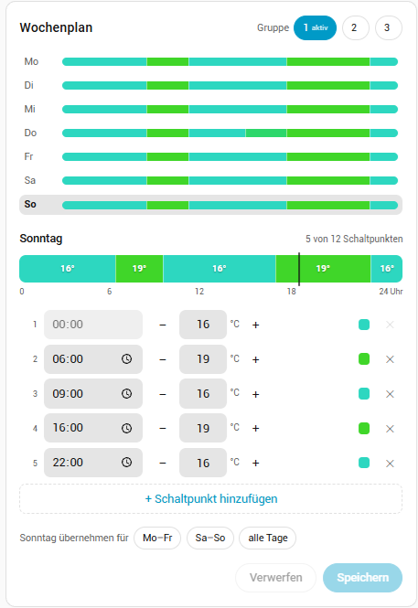

# TRV-ZBL weekly schedule card for Home Assistant

A Home Assistant dashboard card for editing the weekly heating schedule of the **SONOFF TRV-ZBL** thermostatic radiator valve, connected through **Zigbee2MQTT**.

The valve stores each day as a line of text such as `00:00/16 06:00/19 22:00/16`. Typing that by hand is error-prone. This card turns it into a form with a time picker and temperature buttons, checks the input, and writes a valid schedule back to the valve.



[](https://my.home-assistant.io/redirect/marketplace_repository/?owner=ifi-smarthome&repository=trv-schedule-card&category=plugin)

## Features

- **Week overview** with a colour bar per day (blue = cool, red = warm). Click a day to edit it.
- **Day editor** with up to 12 switch points. Each switch point has a time picker and a temperature with −/+ in 0.5 °C steps, limited to 5–30 °C.
- **Input checks before saving**: the first switch point is fixed at 00:00, points stay in time order, and duplicate times are flagged.
- **Copy a day** to Mon–Fri, Sat–Sun or all days, then save all changed days at once.
- **Schedule groups 1–3**: choose which group to edit. The group used in auto mode is marked as active. The selector is hidden on Zigbee2MQTT versions without schedule groups.
- **Visual editor** in the dashboard card picker, including automatic selection of the first TRV-ZBL found.
- **German and English**, following the Home Assistant user language.
- Uses the Home Assistant theme colours, so it fits light and dark themes.

## Requirements

- Home Assistant 2024.8 or newer.
- Zigbee2MQTT with the **Home Assistant integration** enabled, so the valve's entities appear in Home Assistant.
- For a manual installation through the UI: **Advanced mode** enabled in your Home Assistant user profile.

## Installation

### Option A: Marketplace (Home Assistant 2026.11 and newer)

1. Click the **Open in Home Assistant** button at the top of this page, or add the repository by hand under **Settings → Marketplace → Add from link**:
   - Link: `https://github.com/ifi-smarthome/trv-schedule-card`
   - Type: **Dashboard**
2. Open **TRV-ZBL Schedule Card** and choose **Install**.
3. Reload the browser (Ctrl+Shift+R or Cmd+Shift+R).

The Marketplace adds the dashboard resource for you, and new versions show up under **Settings → Updates**. If you manage dashboard resources in YAML, the install dialog shows the line to add instead.

Adding a repository by link asks you to connect a GitHub account once. Once the card is part of the default catalog, you will find it by searching in the Marketplace, and no GitHub account is needed.

Coming from HACS? Home Assistant 2026.11 moves your HACS installs into the Marketplace automatically. The card stays installed and keeps receiving updates.

### Option B: HACS (Home Assistant 2026.10 and older)

1. In HACS, open **⋮ → Custom repositories**.
2. Repository: `https://github.com/ifi-smarthome/trv-schedule-card`, type: **Dashboard**.
3. Open **TRV-ZBL Schedule Card**, download it and reload the browser.

### Option C: Manual installation

1. Download `trv-schedule-card.js` from the [latest release](https://github.com/ifi-smarthome/trv-schedule-card/releases/latest) and copy it to `/config/www/`. If the `www` folder did not exist before, create it and restart Home Assistant once.
2. Go to **Settings → Dashboards → ⋮ → Resources → Add resource** and enter:
   - URL: `/local/trv-schedule-card.js?v=1`
   - Resource type: **JavaScript module**
3. Reload the browser (on mobile, restart the app).

If **Resources** is missing from the menu, enable **Advanced mode** in your user profile first. With dashboards in YAML mode, add the resource to `configuration.yaml` instead:

```yaml
lovelace:
  resources:
    - url: /local/trv-schedule-card.js?v=1
      type: module
```

After a manual update, increase the number at the end of the URL (`?v=2`, …) so browsers load the new file.

## Add the card

**Using the card picker**

1. Open a dashboard and click the pencil icon to edit it.
2. Click **Add card** and search for **TRV-ZBL weekly schedule**.
3. Select the thermostat. The card picks the first TRV-ZBL it finds automatically.
4. Save.

**Using YAML**

```yaml
type: custom:trv-schedule-card
entity: climate.living_room_trv
```

## Configuration

| Option | Required | Description |
|---|---|---|
| `entity` | yes* | The climate entity of the valve, e.g. `climate.living_room_trv` |
| `prefix` | yes* | Alternative to `entity`: only the name part, e.g. `living_room_trv` |
| `title` | no | Card title. Default: "Weekly schedule" or "Wochenplan" |
| `language` | no | `en` or `de`. Default: the Home Assistant user language |

\* Use either `entity` or `prefix`.

Example with all options:

```yaml
type: custom:trv-schedule-card
entity: climate.living_room_trv
title: Living room
language: en
```

## Which entities the card uses

The card derives all entity IDs from the climate entity. For `climate.living_room_trv` it uses:

| Purpose | Entity |
|---|---|
| Schedule per day | `text.living_room_trv_weekly_schedule_monday` … `_sunday` |
| Group being edited | `select.living_room_trv_schedule_group_to_edit` |
| Group used in auto mode | `select.living_room_trv_schedule_active_group` |

Zigbee2MQTT creates these names from the device's friendly name. If you renamed individual entities in Home Assistant, the card cannot find them. Rename them back to the pattern above.

## How to use it

1. Click a day in the week overview.
2. Change times and temperatures. Use **+ Add switch point** for more points (up to 12) and **✕** to remove one.
3. Optional: use **Apply … to** to copy the day to weekdays, the weekend or all days.
4. Click **Save**. Days with unsaved changes are marked with a dot until then. **Discard** undoes all unsaved changes.

The schedule is only followed when the valve is in **auto** mode, using the group selected as active.

The valve is a battery device and confirms changes the next time it reports, which can take a moment. The card keeps the new schedule on screen until then.

## Schedule format reference

- Per day: `HH:mm/temperature`, separated by spaces, e.g. `00:00/17 06:00/21 09:00/18 17:00/21.5 22:00/17`.
- At most 12 switch points per day. The first one must be at 00:00.
- Temperatures from 5 to 30 °C in 0.5 °C steps.
- The valve pads every day to 12 entries by repeating the last one. The card hides those repeats.

## Troubleshooting

**"Custom element doesn't exist: trv-schedule-card"**
The resource is not loaded. Check that the resource is listed under **Settings → Dashboards → ⋮ → Resources**, then reload the browser without cache (Ctrl+F5 or Cmd+Shift+R). In the mobile app, reset the frontend cache in the Companion app settings, or restart the app.

**"Entity … not found"**
The selected climate entity does not belong to a TRV-ZBL, or the schedule entities are named differently. See *Which entities the card uses*.

**"The stored schedule has an unexpected format"**
The card shows the text it received. Saving replaces it with a valid schedule.

**The card still shows an old version after an update**
Reload the browser without cache. With a manual installation, also increase the number at the end of the resource URL, e.g. `?v=2`. Marketplace and HACS do that for you.

**The Marketplace refuses to install the card**
The Marketplace stores cards in a folder named after the repository. If a card with the same repository name `trv-schedule-card` from another owner is installed, remove that one first.

## Contributing

Bug reports and ideas are welcome as [issues](https://github.com/ifi-smarthome/trv-schedule-card/issues). Please include your Home Assistant and Zigbee2MQTT versions and, for schedule problems, the raw text the card shows.

## Disclaimer

This is a community project and not an official SONOFF or ITEAD product. SONOFF is a trademark of its respective owner.

## License

[MIT](LICENSE)
